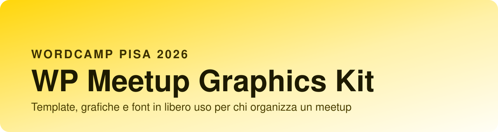
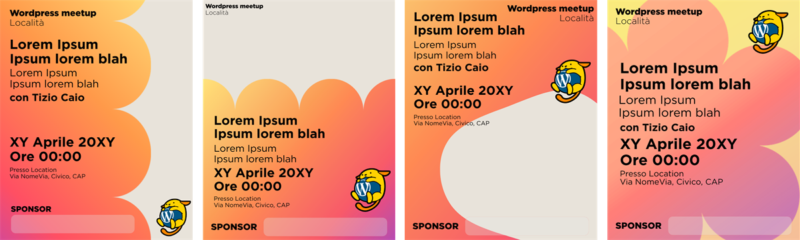
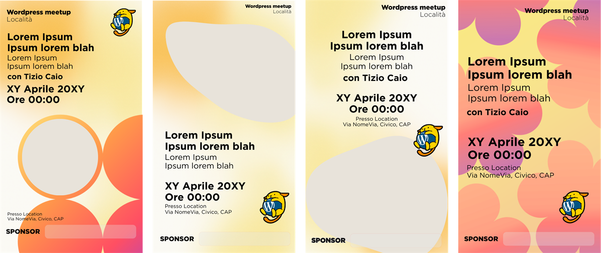
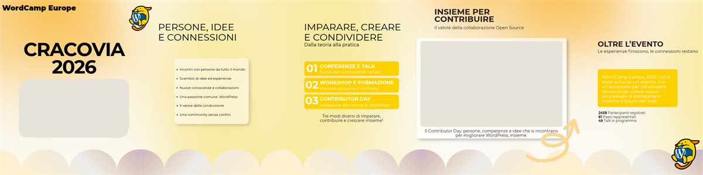
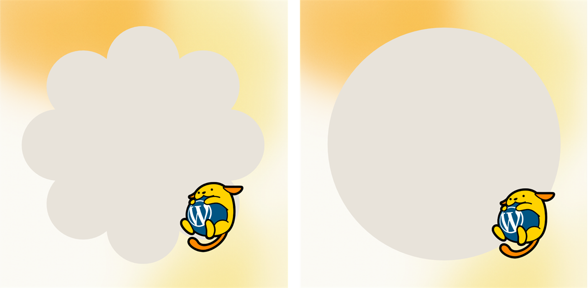
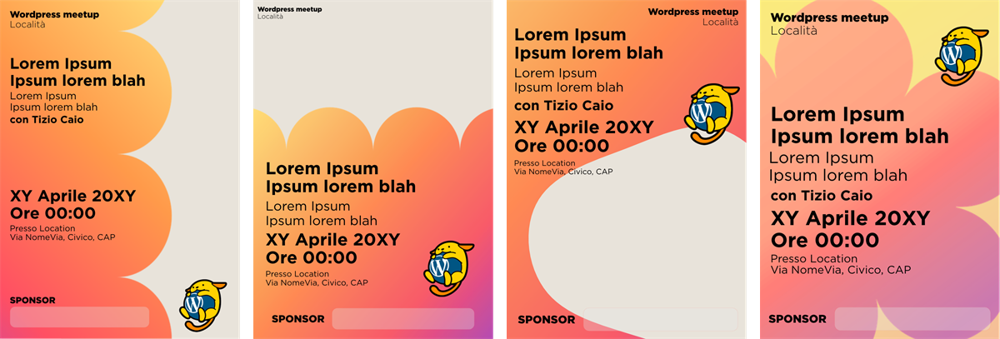

<p align="center">
  
</p>

<p align="center">
  <b>Everything you need to give your WordPress meetup a face.</b><br>
  Presented at WordCamp Pisa 2026 · Free to use · Open to contributions
</p>

<p align="center">
  <a href="#-whats-in-the-kit">What's inside</a> ·
  <a href="#-canva-templates">Canva templates</a> ·
  <a href="#-how-to-download-the-kit">Download</a> ·
  <a href="#-how-to-edit-the-templates">Edit</a> ·
  <a href="#-license">License</a> ·
  <a href="#-how-to-contribute">Contribute</a> ·
  <a href="README.md">🇮🇹 Italiano</a>
</p>


## ✨ What it is

Running a meetup takes enough work already, and graphics shouldn't slow you down. This kit collects **ready-made templates** and **free graphic resources** for your WordPress meetup: save the dates, reminders, event recaps, profile kits and posters.

Start from the Canva templates if you're in a hurry. Download the resources if you want to go further with your own tools (Figma, Photoshop, Illustrator, Affinity, whatever you like).


## 📦 What's in the kit

The folders have Italian names. Here's what each one holds.

```
wordpress-meetup-kit/
├── README.md            → Italian version of this page
├── README.en.md
├── LICENSE
├── CONTRIBUTING.md
├── wordpress-meetup-kit.pdf → guide with previews and direct links (Italian)
├── pdf/                 → every template as a PDF
├── template-affinity/   → source files to open in Affinity
├── anteprime/           → preview images of the templates
└── assets/              → free graphic resources
    ├── wapuus/          → Wapuu mascots in different styles
    ├── gradienti/       → gradient backgrounds
    ├── forme/           → gradient shapes and decorations
    ├── font/            → open license fonts
    └── brand/           → meetup logos and identity
```

| Folder | Contents | Formats |
|---|---|---|
| `pdf/` | All templates, ready to print or share | PDF |
| `template-affinity/` | Template source files | AF (Affinity 3) |
| `anteprime/` | One preview image per template | PNG |
| `assets/wapuus/` | Wapuus and variations | SVG, PNG |
| `assets/gradienti/` | Soft gradient backgrounds in three formats (portrait, landscape, panoramic) | JPG |
| `assets/forme/` | Gradient clouds, flower and circles, sponsor boxes, photo frames | PNG with transparency, SVG |
| `assets/font/` | Open source fonts, each with its own license | TTF, OTF |
| `assets/brand/` | Meetup logos and identity | SVG, PNG |


## 🎨 Canva templates

Click, duplicate, customize. A free Canva account is all you need. Every template is also available as a PDF.

The versions of a template live in the same design, one per page. When you open the Canva link you get all of them: keep the one you need and delete the rest. In the Canva templates, PDFs and previews, the grey shape marks where your photo goes: in Canva, just drag your image onto it.

> 📄 Sharing the kit with someone who doesn't use GitHub? Send them [`wordpress-meetup-kit.pdf`](wordpress-meetup-kit.pdf): it's a guide, in Italian, with every preview and direct links to Canva, the PDFs and the Affinity files.

### 📅 Save the date



| Format | Versions | Canva | PDF |
|---|---|---|---|
| Post 4:5 | 3 with a photo, 1 type only | [Open in Canva](https://canva.link/ystrq4ud9vspvyh) | [PDF](pdf/save-the-date_post-4x5.pdf) |
| Stories 9:16 | 3 with a photo, 1 type only | [Open in Canva](https://canva.link/iepbwtuul3rl8dt) | [PDF](pdf/save-the-date_stories-9x16.pdf) |

### 🔔 Reminder



| Format | Versions | Canva | PDF |
|---|---|---|---|
| Post 4:5 | 3 with a photo, 1 type only | [Open in Canva](https://canva.link/l5xqpu4af0pzzk9) | [PDF](pdf/promemoria_post-4x5.pdf) |
| Stories 9:16 | 3 with a photo, 1 type only | [Open in Canva](https://canva.link/kkydye1pmmiz9xb) | [PDF](pdf/promemoria_stories-9x16.pdf) |

### 🎠 Carousel



| Template | Slides | Canva | PDF |
|---|---|---|---|
| Event recap, with WordCamp Europe 2026 as the example | 5 | [Open in Canva](https://canva.link/n4lqpyv5e31503n) | [PDF](pdf/carosello_recap-evento.pdf) |

### 👤 Profile kit



| Item | Versions | Canva | PDF |
|---|---|---|---|
| Avatar | 2 (flower and circle) | [Open in Canva](https://canva.link/o7a06vxfk3qimfs) | [PDF](pdf/kit-profilo_avatar.pdf) |
| LinkedIn cover | 1 | [Open in Canva](https://canva.link/xvimdha01su9218) | [PDF](pdf/kit-profilo_copertina-linkedin.pdf) |
| Facebook cover | 1 | [Open in Canva](https://canva.link/tbaa9ua8wkdrcmm) | [PDF](pdf/kit-profilo_copertina-facebook.pdf) |
| Meetup.com event cover | 1 | [Open in Canva](https://canva.link/6w9petz7oge1pg0) | [PDF](pdf/kit-profilo_copertina-evento-meetup.pdf) |

### 🖨️ Printable poster



| Format | Versions | Canva | PDF |
|---|---|---|---|
| A4 | 3 with a photo, 1 type only | [Open in Canva](https://canva.link/10clq2lgqrucckd) | [PDF](pdf/locandina_a4.pdf) |
| A3 | 3 with a photo, 1 type only | [Open in Canva](https://canva.link/ll27m10vguo95u0) | [PDF](pdf/locandina_a3.pdf) |
| A2 | 3 with a photo, 1 type only | [Open in Canva](https://canva.link/3vexegk579hf1iy) | [PDF](pdf/locandina_a2.pdf) |


## 📥 How to download the kit

**You don't need to know git.**

1. Click the green **Code** button at the top of this page
2. Choose **Download ZIP**
3. Unzip the folder on your computer: everything is in there

If you prefer the terminal:

```bash
git clone https://github.com/Lelevisione/wordpress-meetup-kit.git
```


## 🔧 How to edit the templates

**With Canva.** Open the template link from the tables above. Canva asks you to use the template and creates a copy in your account, so you can change text, photos and colors and the original stays as it is.

**With Affinity.** Download the kit and open the file you need from the `template-affinity/` folder: they're Affinity 3 `.af` files, with editable text, shapes and images. Install Montserrat first, which you'll find in `assets/font/montserrat/`, so Affinity doesn't replace it with another font.

Each template has the same name in `pdf/`, `template-affinity/` and `anteprime/`. If you like `promemoria_post-4x5.pdf`, the Affinity source has the same name.


## 🔤 A note on fonts

The fonts in the `assets/font/` folder have an **open license** (for example the SIL Open Font License) and you can use them freely. Each family has its own folder with the original license file inside.

The PDFs in the kit use **Montserrat**, by The Montserrat Project Authors, under the SIL Open Font License 1.1: you'll find it in `assets/font/montserrat/` together with `OFL.txt`. The Canva templates use Gotham instead, except for the carousel, which uses Montserrat there too. Gotham is a commercial font that you can use in Canva even with a free account. Outside Canva it needs a license, so it isn't in the kit: if you work with other tools, you can use Montserrat in its place, with these weights.

| Gotham, in the Canva templates | Montserrat, in the PDFs |
|---|---|
| Light | Light |
| Book | Regular |
| Bold | Bold |
| Black | Black |


## 📜 License

The resources in this kit are released under **[Creative Commons Attribution 4.0 (CC BY 4.0)](https://creativecommons.org/licenses/by/4.0/deed.en)**.

You can:

- ✅ use them for your meetup, commercial contexts included
- ✅ change and adapt them
- ✅ share them

One condition: **credit the source**. A line like this one is enough:

> Graphics from the WordPress Meetup Kit by Gabriele Ruffini and Elisa Puddu (WordPress Pisa Meetup), CC BY 4.0

The full license text is in the [`LICENSE`](LICENSE) file. Some items in the kit have their own license, which applies to them instead of CC BY 4.0: they're listed below.

### Wapuus

All the wapuus in `assets/wapuus/` are licensed under the GNU GPL v2 or later, with the full text in [`assets/wapuus/GPL-2.0.txt`](assets/wapuus/GPL-2.0.txt). Wapuu is the official character of ja.wordpress.org, designed by Kazuko Kaneuchi, who keeps the copyright. The other versions derive from the original and stay under the GPL, with the copyright of whoever drew them: when you use one, credit its designer.

| Designer | Wapuu | Source |
|---|---|---|
| Kazuko Kaneuchi | `wapuu-original.svg`, also used in the templates with a white outline | [jawordpressorg/wapuu](https://github.com/jawordpressorg/wapuu) |
| Silvia Goldhammer, for WordCamp Nuremberg 2016 | the three `speaker-*` time signs for speakers and `catering-wapuu.svg` | [Wapuu archive](https://github.com/jawordpressorg/wapuu/tree/master/wapuu-archive) |
| Gemma Evans | `wapmas-wapuu.svg`, `wapevil-wapuu.svg` | [Wapuu archive](https://github.com/jawordpressorg/wapuu/tree/master/wapuu-archive) |
| Michelle Schulp Hunt | the 11 `wapuu-*.png` files | [marktimemedia/wapuu](https://github.com/marktimemedia/wapuu) |
| Elaine Shannon | `eduwapuu.png` | [Wapuu archive](https://github.com/jawordpressorg/wapuu/tree/master/wapuu-archive) |

Designers and sources come from the official [wapuu-api](https://github.com/jawordpressorg/wapuu-api) list.

### Carousel arrow

The carousel contains a decorative arrow from the Canva library. The arrow is left out of the kit: you won't find it in `assets/` and CC BY doesn't cover it.

### Trademarks

WordPress and WordCamp are trademarks of the WordPress Foundation. The WordPress Meetup Kit is a community project, born at the WordPress Pisa Meetup, and it isn't an official product of the WordPress Foundation. Many wapuus hold the WordPress logo: if you use the WordPress name or logo in your graphics, follow the [WordPress Foundation trademark policy](https://wordpressfoundation.org/trademark-policy/).


## 🤝 How to contribute

The kit is meant to grow with the community. You can contribute in two ways.

**If you use GitHub**
1. **Fork** the repository
2. Add or improve your resources
3. Open a **pull request**: we'll review it together and add it

**If you don't use git**
Open an [**issue**](../../issues/new/choose) with your files attached, a GitHub account is enough: we'll add them for you.

Before sending anything, read [`CONTRIBUTING.md`](CONTRIBUTING.md) for formats, file names and the license of contributions. It's in Italian with a short English summary at the end.

Got an idea or missing something? Open an [issue](../../issues) and tell us what you need.


## 💛 Credits

A kit born in the WordPress meetup community, presented at **WordCamp Pisa 2026** by Gabriele Ruffini and Elisa Puddu of the WordPress Pisa Meetup.

Thanks to everyone who will help it grow.

<p align="center">
  <a href="https://www.linkedin.com/in/gabrieleruffini"></a>
  <a href="https://www.linkedin.com/in/elisapudduu"></a>
</p>
