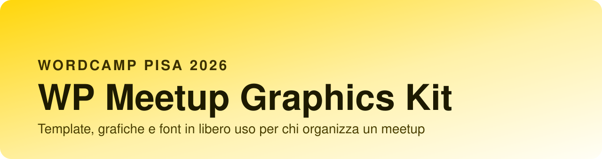
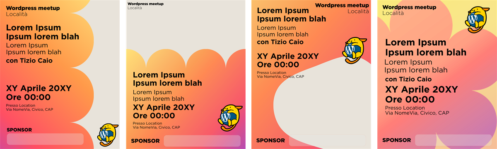
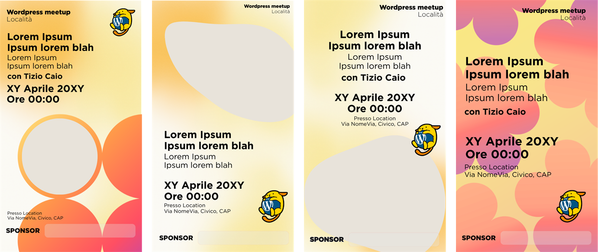
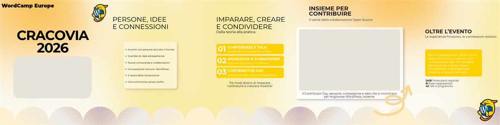
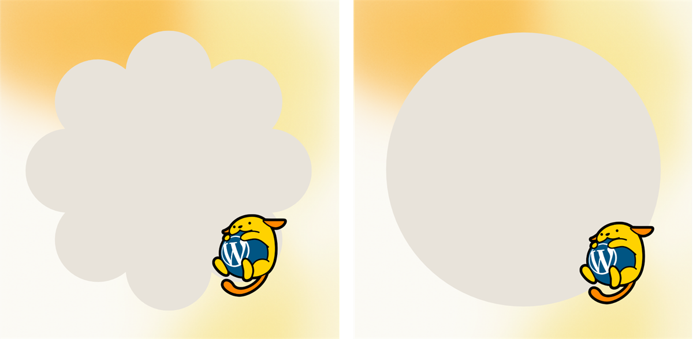
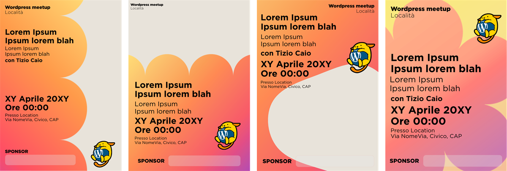

<p align="center">
  
</p>

<p align="center">
  <b>Tutto quello che serve per dare un volto al tuo meetup WordPress.</b><br>
  Presentato al WordCamp Pisa 2026 · Libero uso · Aperto ai contributi
</p>

<p align="center">
  <a href="#-cosa-trovi-nel-kit">Cosa trovi</a> ·
  <a href="#-template-canva">Template Canva</a> ·
  <a href="#-come-scaricare-il-kit">Scarica</a> ·
  <a href="#-come-modificare-i-template">Modifica</a> ·
  <a href="#-licenza">Licenza</a> ·
  <a href="#-come-contribuire">Contribuisci</a> ·
  <a href="README.en.md">🇬🇧 English</a>
</p>


## ✨ Cos'è

Organizzare un meetup è già abbastanza impegnativo: la grafica non dovrebbe essere un ostacolo. Questo kit raccoglie **template pronti all'uso** e **risorse grafiche libere** per save the date, promemoria, recap, kit profilo e locandine del tuo meetup WordPress.

Parti dai template Canva se vuoi fare in fretta. Scarica le risorse se vuoi spingerti oltre e lavorare con i tuoi strumenti (Figma, Photoshop, Illustrator, Affinity, quello che preferisci).


## 📦 Cosa trovi nel kit

```
wordpress-meetup-kit/
├── README.md
├── README.en.md
├── LICENSE
├── LICENSES.md
├── CONTRIBUTING.md
├── canva-templates.pdf
├── pdf/                 → ogni template in PDF
├── template-affinity/   → file sorgente da aprire con Affinity
├── anteprime/           → immagini di anteprima dei template
└── assets/              → risorse grafiche libere
    ├── wapuus/          → mascotte Wapuu in vari stili
    ├── gradienti/       → sfondi sfumati pronti all'uso
    ├── forme/           → forme e decorazioni vettoriali
    ├── font/            → font con licenza aperta
    └── brand/           → loghi e identità del meetup
```

| Cartella | Contenuto | Formati |
|---|---|---|
| `pdf/` | Tutti i template, pronti da stampare o condividere | PDF |
| `template-affinity/` | File sorgente dei template | Affinity |
| `anteprime/` | Un'immagine per ogni template | PNG |
| `assets/wapuus/` | Wapuu e varianti | SVG, PNG |
| `assets/gradienti/` | Gradienti e sfondi | PNG, JPG |
| `assets/forme/` | Forme, pattern, decorazioni | SVG |
| `assets/font/` | Font open source, ognuno con la sua licenza | TTF, OTF |
| `assets/brand/` | Loghi e identità del meetup | SVG, PNG |


## 🎨 Template Canva

Clicca, duplica, personalizza. Serve solo un account Canva gratuito. Ogni template c'è anche in PDF.

Le versioni di un template stanno nello stesso design, una per pagina. Quando apri il link Canva le ricevi tutte: tieni quella che ti serve e cancella le altre. Nei PDF e nelle anteprime il riquadro grigio indica dove va la tua foto.

### 📅 Save the date



| Formato | Versioni | Canva | PDF |
|---|---|---|---|
| Post 4:5 | 3 con foto, 1 solo tipografica | [Apri su Canva](#) | [PDF](pdf/save-the-date_post-4x5.pdf) |
| Stories 9:16 | 3 con foto, 1 solo tipografica | [Apri su Canva](#) | [PDF](pdf/save-the-date_stories-9x16.pdf) |

### 🔔 Promemoria



| Formato | Versioni | Canva | PDF |
|---|---|---|---|
| Post 4:5 | 3 con foto, 1 solo tipografica | [Apri su Canva](#) | [PDF](pdf/promemoria_post-4x5.pdf) |
| Stories 9:16 | 3 con foto, 1 solo tipografica | [Apri su Canva](#) | [PDF](pdf/promemoria_stories-9x16.pdf) |

### 🎠 Carosello



| Template | Slide | Canva | PDF |
|---|---|---|---|
| Recap di un evento, con l'esempio di WordCamp Europe 2026 | 5 | [Apri su Canva](#) | [PDF](pdf/carosello_recap-evento.pdf) |

### 👤 Kit profilo



| Elemento | Versioni | Canva | PDF |
|---|---|---|---|
| Avatar | 2 (fiore e cerchio) | [Apri su Canva](#) | [PDF](pdf/kit-profilo_avatar.pdf) |
| Copertina LinkedIn | 1 | [Apri su Canva](#) | [PDF](pdf/kit-profilo_copertina-linkedin.pdf) |
| Copertina Facebook | 1 | [Apri su Canva](#) | [PDF](pdf/kit-profilo_copertina-facebook.pdf) |
| Copertina evento Meetup.com | 1 | [Apri su Canva](#) | [PDF](pdf/kit-profilo_copertina-evento-meetup.pdf) |

### 🖨️ Locandina stampabile



| Formato | Versioni | Canva | PDF |
|---|---|---|---|
| A4 | 3 con foto, 1 solo tipografica | [Apri su Canva](#) | [PDF](pdf/locandina_a4.pdf) |
| A3 | 3 con foto, 1 solo tipografica | [Apri su Canva](#) | [PDF](pdf/locandina_a3.pdf) |
| A2 | 3 con foto, 1 solo tipografica | [Apri su Canva](#) | [PDF](pdf/locandina_a2.pdf) |

> 📄 In questa repo trovi anche [`canva-templates.pdf`](canva-templates.pdf): un unico PDF con tutte le anteprime e i link, comodo da stampare o condividere con il tuo team.


## 📥 Come scaricare il kit

**Non serve saper usare git.**

1. Clicca sul pulsante verde **Code** in alto in questa pagina
2. Scegli **Download ZIP**
3. Decomprimi la cartella sul tuo computer: è tutto lì

Se invece preferisci il terminale:

```bash
git clone https://github.com/Lelevisione/wordpress-meetup-kit.git
```


## 🔧 Come modificare i template

**Con Canva.** Apri il link del template dalle tabelle qui sopra. Canva ti propone di usare il modello e crea una copia nel tuo account: da lì cambi testi, foto e colori senza toccare l'originale.

**Con Affinity.** Scarica il kit e apri il file che ti serve dalla cartella `template-affinity/`. Prima installa i font elencati in [`LICENSES.md`](LICENSES.md), così Affinity non li sostituisce con altri.

Ogni template ha lo stesso nome in `pdf/`, `template-affinity/` e `anteprime/`. Se ti piace `promemoria_post-4x5.pdf`, il sorgente Affinity si chiama allo stesso modo.


## 🔤 Nota sui font

I font inclusi nella cartella `assets/font/` hanno **licenza aperta** (ad esempio SIL Open Font License) e puoi usarli liberamente. Ogni famiglia ha la sua cartella, con dentro il file di licenza originale.

I PDF del kit usano **Montserrat**, che trovi in `assets/font/montserrat/`. I modelli Canva usano invece Gotham, un font commerciale: se il tuo account Canva non ce l'ha, Canva lo sostituisce e puoi scegliere Montserrat al suo posto. In [`LICENSES.md`](LICENSES.md) trovi quale peso di Montserrat corrisponde a ogni peso di Gotham.


## 📜 Licenza

Le risorse di questo kit sono rilasciate con licenza **[Creative Commons Attribution 4.0 (CC BY 4.0)](https://creativecommons.org/licenses/by/4.0/deed.it)**.

In pratica puoi:

- ✅ usarle per il tuo meetup, anche in contesti commerciali
- ✅ modificarle e adattarle
- ✅ condividerle

A una condizione: **cita la fonte**. Basta una riga come questa:

> Grafiche dal WordPress Meetup Kit di Gabriele Ruffini ed Elisa Puddu (WordPress Pisa Meetup), CC BY 4.0

> ⚠️ Alcuni elementi (come certi Wapuu o font) hanno una licenza propria, elencata in [`LICENSES.md`](LICENSES.md). Per quegli elementi vale la loro licenza.


## 🤝 Come contribuire

Il kit è pensato per crescere con la community. Puoi contribuire in due modi.

**Se usi GitHub**
1. Fai un **fork** della repository
2. Aggiungi o migliora le tue risorse
3. Apri una **pull request**: la guardiamo insieme e la inseriamo

**Se non usi git**
Apri una [**issue**](../../issues/new/choose) allegando i tuoi file (ti basta un account GitHub), oppure scrivici a **TODO: contatto**: li inseriamo noi.

Prima di inviare qualcosa, leggi [`CONTRIBUTING.md`](CONTRIBUTING.md) per i dettagli su formati, nomi dei file e licenza dei contributi.

Hai un'idea o manca qualcosa? Apri una [issue](../../issues) e dicci cosa ti servirebbe.


## 💛 Crediti

Un kit nato dalla community dei meetup WordPress, presentato al **WordCamp Pisa 2026** da Gabriele Ruffini ed Elisa Puddu del WordPress Pisa Meetup.

Grazie a tutte le persone che contribuiranno a farlo crescere.

---

<sub>🇬🇧 **In English:** the full version of this page is in [README.en.md](README.en.md).</sub>
